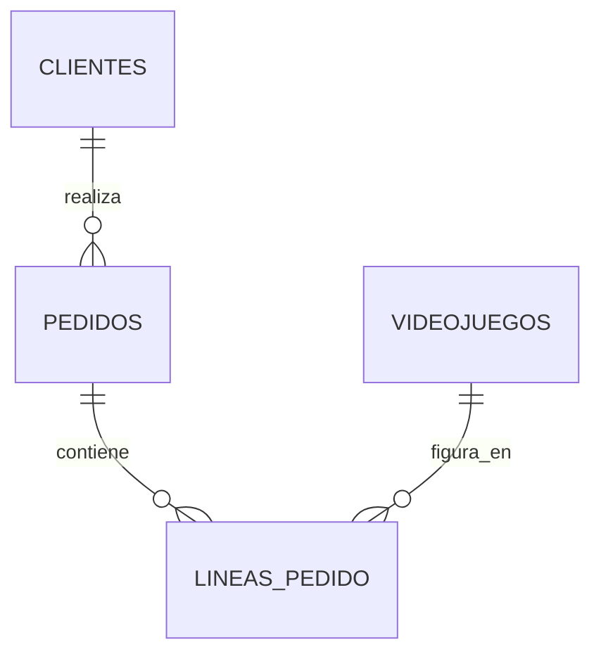

# Modelo de datos

La práctica usa una tienda ficticia. El esquema de [`tienda.sql`](../tienda.sql) contiene cuatro tablas y sus claves foráneas.

## Tablas

### `clientes`

| Columna | Tipo | Uso |
| --- | --- | --- |
| `id` | `INTEGER` | Clave primaria del cliente. |
| `nombre` | `TEXT` | Nombre ficticio. |

### `videojuegos`

| Columna | Tipo | Uso |
| --- | --- | --- |
| `id` | `INTEGER` | Clave primaria del juego. |
| `titulo` | `TEXT` | Título único del catálogo. |
| `precio_euros` | `INTEGER` | Precio anunciado en el catálogo. No admite valores negativos. |

### `pedidos`

| Columna | Tipo | Uso |
| --- | --- | --- |
| `id` | `INTEGER` | Clave primaria del pedido. |
| `cliente_id` | `INTEGER` | Clave foránea que apunta a `clientes.id`. |
| `fecha` | `TEXT` | Fecha guardada con el formato `AAAA-MM-DD`. |

### `lineas_pedido`

| Columna | Tipo | Uso |
| --- | --- | --- |
| `id` | `INTEGER` | Clave primaria de la línea. |
| `pedido_id` | `INTEGER` | Clave foránea que apunta a `pedidos.id`. |
| `videojuego_id` | `INTEGER` | Clave foránea que apunta a `videojuegos.id`. |
| `unidades` | `INTEGER` | Cantidad de juegos de esa línea, siempre mayor que cero. |
| `precio_unitario_euros` | `INTEGER` | Precio por unidad registrado en esa línea. No admite valores negativos. |

## Cómo se relacionan

- Un cliente puede tener varios pedidos. Cada pedido pertenece a un cliente.
- Un pedido puede tener varias líneas. Cada línea pertenece a un solo pedido.
- Un videojuego puede aparecer en varias líneas. Cada línea se refiere a un solo videojuego.
- La combinación de `pedido_id` y `videojuego_id` no se repite dentro de `lineas_pedido`.

`videojuegos.precio_euros` describe el catálogo. `lineas_pedido.precio_unitario_euros` guarda el precio por unidad de una venta. En este conjunto de ejemplo ambos precios coinciden, pero representan datos distintos.

La base de práctica contiene 7 clientes, 8 videojuegos, 8 pedidos y 15 líneas de pedido. Todos los nombres y transacciones son ficticios.
